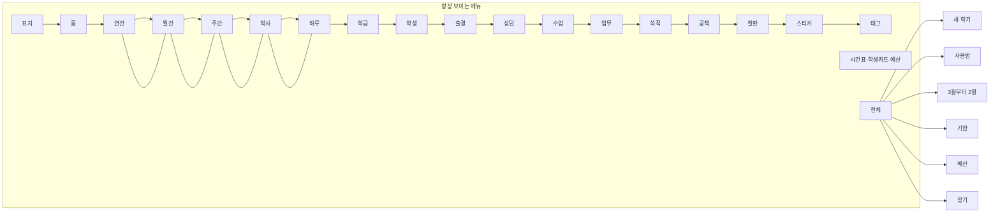
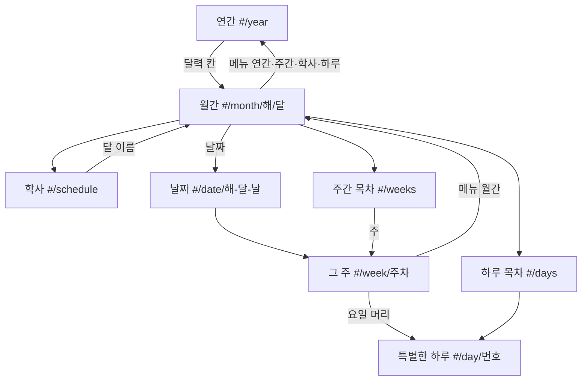

# 내비게이션 지도

항상 보이는 위쪽 메뉴와 해시 주소로 움직인다. 어느 쪽에서든 메뉴의 목적지는 한 번, `전체` 안에만 있는 목적지는 두 번(전체 → 항목)에 닿는다. 브라우저 뒤로 가기는 `history.pushState`라서 직전 주소로 돌아간다.

기존 `#p쪽번호`도 그대로 연다. 1–580은 이름 있는 주소로 바뀐다. `#p999`처럼 범위를 넘으면 580쪽으로 옮기고 짧게 알린다. `#p0`과 없는 이름은 표지로 옮기고 알린다. 맞는 `#/date/해-달-날` 은 주 번호로 바꾸지 않는다. 메뉴·날짜·바로가기를 누르면 아래의 이름 있는 주소로 쌓인다.

800px 이하와 휴대폰(360 포함)에서는 용지 안 홈·쓱·연간 탭 줄을 두지 않는다. 그 목적지는 위 52px 쪽 바로가기 줄에서 한 번에 연다. 달 12개는 `전체`에서 고른다.

## 주소

| 주소 | 쪽 | 메뉴에서 켜지는 위치 |
| --- | --- | --- |
| `#/cover` | 1 표지 | 표지 |
| `#/home` | 2 홈 | 홈 |
| `#/prep` | 3 새 학기 | 홈 구간 (2–8) |
| `#/guide` | 5 사용법 | 홈 구간 |
| `#/tags` | 9 태그 | 태그 |
| `#/year` | 32 연간 | 연간 |
| `#/schedule` | 33 학사일정 | 학사 |
| `#/month/2026/3` … `#/month/2026/12`, `#/month/2027/1`, `#/month/2027/2` | 34–45 | 월간 |
| `#/weeks` | 46 주간 목차 | 주간 |
| `#/week/1` … `#/week/52` | 47–98 | 주간 |
| `#/date/2026-03-05` | 그 날짜가 들어 있는 주 | 주간 |
| `#/days` | 99 특별한 하루 목차 | 하루 |
| `#/day/1` … `#/day/40` | 100–139 | 하루 |
| `#/class` | 140 학급 | 학급 |
| `#/timetable` | 141 시간표 | 막대 칩. 학급 구간 |
| `#/students` | 154 명렬 | 학생 |
| `#/cards` | 159 1번 학생 카드 | 막대 칩. 학생 구간. 열리면 `#/cards/1` |
| `#/cards/1` … `#/cards/32` | 159, 161, … 해당 학생 카드 | 학생 구간. `#/cards/2`는 161 |
| `#/attend` | 231 출결 | 출결 |
| `#/counsel` | 256 상담 | 상담 |
| `#/lesson` | 335 수업 | 수업 |
| `#/work` | 404 업무 | 업무 |
| `#/deadlines` | 405 기한 | 업무 구간 |
| `#/budget` | 468 예산 | 막대 칩. 업무 구간 |
| `#/write` | 496 쓱적 | 쓱적 |
| `#/notebook` | 516 공책 | 공책 |
| `#/board` | 559 칠판 | 칠판 |
| `#/stickers` | 563 스티커 | 스티커 |
| `#/p/쪽` 와 `#p쪽` | 그 쪽 | 그 쪽이 속한 구간 |

## 그림

달력끼리는 메뉴에서 바로 건너다닌다.

`전체`를 열면 같은 목적지가 묶음으로 다시 있다. 막대 밖으로 스크롤된 항목도 여기서 두 번째 클릭으로 연다.
